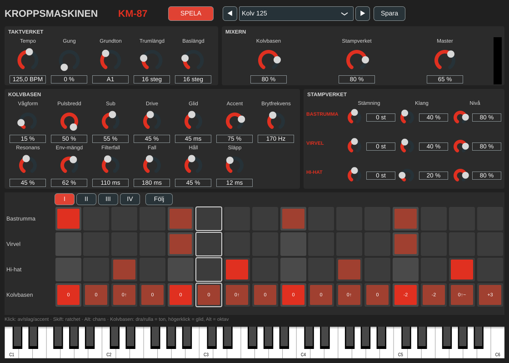

# Kroppsmaskinen

*Modell KM-87.* En groovebox för Electronic Body Music och New Beat. Instrument-plugin (VST3, AU, CLAP) och fristående app för macOS. Allt ljud är syntetiskt.

**Status: fas 0 klar i kod, grind 0 återstår.** Se [PLAN.md](PLAN.md) för hela planen.

I fas 0 finns:

- **Kolvbasen:** monofon sekvensbas med sågtand som tonar över i puls, sub, ett 24 dB-ladderfilter med snabb filterenvelope, accent och glid.
- **Stampverket:** bastrumma, virvel och hi-hat. Mönstret har redan plats för alla tolv spår.
- **Taktverket:** sextondelar med gung, egen klocka eller DAW:ens transport, olika längd för trummor och bas (polymeter), transponering från keyboardet.
- **Mönster:** 16 steg per sida, sidorna I–IV (upp till 64 steg). Trummor med accent, chans och ratchets; Kolvbasen med accent, glid, oktav och tonlängd.
- **Fabriksbandet:** fyra presets – *Init*, *Kolv 125* (grind 0-loopen), *Marsch 120* och *New Beat 112*.
- **Ett grått gränssnitt** med standardrattar, bara för att kunna spela. VHS-panelen kommer i fas 3.



## Spela

Tryck **SPELA** i den fristående appen. I en DAW följer sekvensern DAW:ens transport.

Stegrutnätet:

| Var | Gör |
| --- | --- |
| Trummor, klick | av → slag → accent |
| Trummor, Skift-klick | ratchet: 1, 2, 3 eller 4 slag inom steget |
| Trummor, Alt-klick | chans: 100, 75, 50 eller 25 % |
| Kolvbasen, klick | av → ton → accent |
| Kolvbasen, dra upp/ned eller rulla | tonen, ±12 halvtoner från grundtonen |
| Kolvbasen, högerklick | glid: tonen hålls och glider in i nästa |
| Kolvbasen, Alt-klick | oktav: 0 → upp → ned |
| I–IV | sidan som visas; **Följ** låter sidan följa uppspelningen |

När sekvensern står still spelar keyboardet Kolvbasen. När den går flyttar en tangent hela basgången (räknat från **Grundton**). MIDI-kanal 10 spelar trummorna (GM-kartan: 36 bastrumma, 38 virvel, 42 hi-hat).

## Bygga lokalt

Samma verktyg som för KrangBox: macOS 14+, Xcode 15+, CMake 3.22+ (och gärna Ninja).

```sh
cmake -B build -G Xcode
cmake --build build --config Release --target Kroppsmaskinen_All
```

Snabbare under utveckling:

```sh
cmake -B build-dev -G Ninja -DCMAKE_BUILD_TYPE=Debug -DCMAKE_OSX_ARCHITECTURES=arm64
cmake --build build-dev --target Kroppsmaskinen_Standalone
open build-dev/Kroppsmaskinen_artefacts/Debug/Standalone/Kroppsmaskinen.app
```

JUCE 8.0.4 och clap-juce-extensions hämtas från GitHub första gången. Har du redan byggt KrangBox kan du återanvända dess kopia:

```sh
cmake -B build -G Xcode \
  -DFETCHCONTENT_SOURCE_DIR_JUCE=../krang-box/build/_deps/juce-src \
  -DFETCHCONTENT_SOURCE_DIR_CLAP-JUCE-EXTENSIONS=../krang-box/build/_deps/clap-juce-extensions-src
```

### Byggmål

| Mål | Bygger |
| --- | --- |
| `Kroppsmaskinen_All` | VST3, AU, CLAP och den fristående appen |
| `Kroppsmaskinen_Standalone` | `Kroppsmaskinen.app` |
| `KMRender` | Renderingstestet och lyssningsfilerna (se nedan) |
| `KMSnapshot` | Ritar panelen till PNG: `KMSnapshot docs/panelen_fas0.png` |

### Installera i din DAW

```sh
cp -R build/Kroppsmaskinen_artefacts/Release/VST3/Kroppsmaskinen.vst3 ~/Library/Audio/Plug-Ins/VST3/
cp -R build/Kroppsmaskinen_artefacts/Release/AU/Kroppsmaskinen.component ~/Library/Audio/Plug-Ins/Components/
mkdir -p ~/Library/Audio/Plug-Ins/CLAP
cp -R build/Kroppsmaskinen_artefacts/Release/CLAP/Kroppsmaskinen.clap ~/Library/Audio/Plug-Ins/CLAP/
```

## Renderingstest och grind 0

```sh
cmake --build build --config Release --target KMRender
./build/KMRender_artefacts/Release/KMRender renders
```

KMRender kontrollerar mönsterformatet, varje ljud för sig (NaN, topp, DC, tystnad efter släpp), att Taktverket slår exakt på stegen, alla fabrikspresets och 40 slumpade ytterlägen. Den avslutar med felkod om något går fel, så CI blir rött.

**Grind 0** är en lyssning: `renders/grind0_kolv125.wav` (åtta takter av *Kolv 125*) ska "sitta" vid A/B mot referensspåren. Basen och trummorna finns också var för sig i `grind0_kolv125_bas.wav` och `grind0_kolv125_trummor.wav`.

## Struktur

| Sökväg | Innehåll | Ursprung |
| --- | --- | --- |
| `Source/dsp/Grund.h` | Byggstenar: polyBLEP, TPT-filter, DC-spärr, mättnad, slump | Ny |
| `Source/dsp/Kolvbasen.h` | Sekvensbasen: oscillatorer, ZDF-ladderfilter, envelopes, accent, glid | Utgår från `Basmalen.h` |
| `Source/dsp/Stampverket.h` | Trummorna och spårens fasta ordning | Ny |
| `Source/dsp/Motor.h` | Kopplar ihop Taktverket, kanalerna, mixern och toppbegränsaren | Ny |
| `Source/takt/Monster.h` | Trummönstret (12 spår) och tonmönstret, med textformatet | Utgår från `Stegverket.h` och `TonStegverket.h` |
| `Source/takt/Taktverket.h` | Klockan: sextondelar, gung, DAW-synk, egen klocka | Utgår från `Stegverket.h` |
| `Source/Parameters.h` | Parameterträdet – ID:n (`km_…`) får aldrig döpas om | Ny |
| `Source/presets/` | Fabriksbandet och PresetManager (`.km87`-filer med formatversion) | Utgår från KrangBox |
| `Source/ui/ValueFormat.h` | Värdeformatet för rattarna | Kopia från KrangBox |
| `Source/ui/StegRutnat.h` | Stegrutnätet | Ny |
| `Source/PluginEditor.*` | Det gråa gränssnittet för fas 0 | Ny |
| `tools/KMRender.cpp` | Renderingstest och lyssningsfiler | Ny |
| `tools/KMSnapshot.cpp` | Ritar panelen till PNG | Ny |
| `.github/workflows/` | macOS-bygge, renderingstest, panelbild och pluginval | Utgår från KrangBox |

Filer som är kopior av KrangBox får inte glida isär i onödan: rättningar förs över för hand tills ett gemensamt bibliotek eventuellt byggs (fas 5).

## Licens

GNU Affero General Public License v3.0 – se [LICENSE](LICENSE). Kroppsmaskinen använder JUCE under dess AGPLv3-licens.
