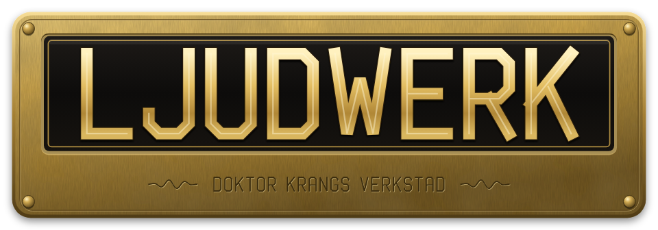
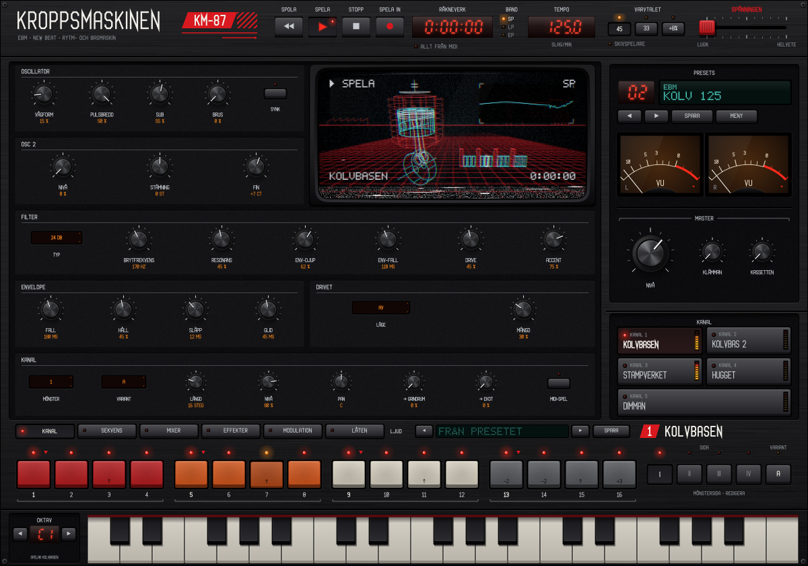
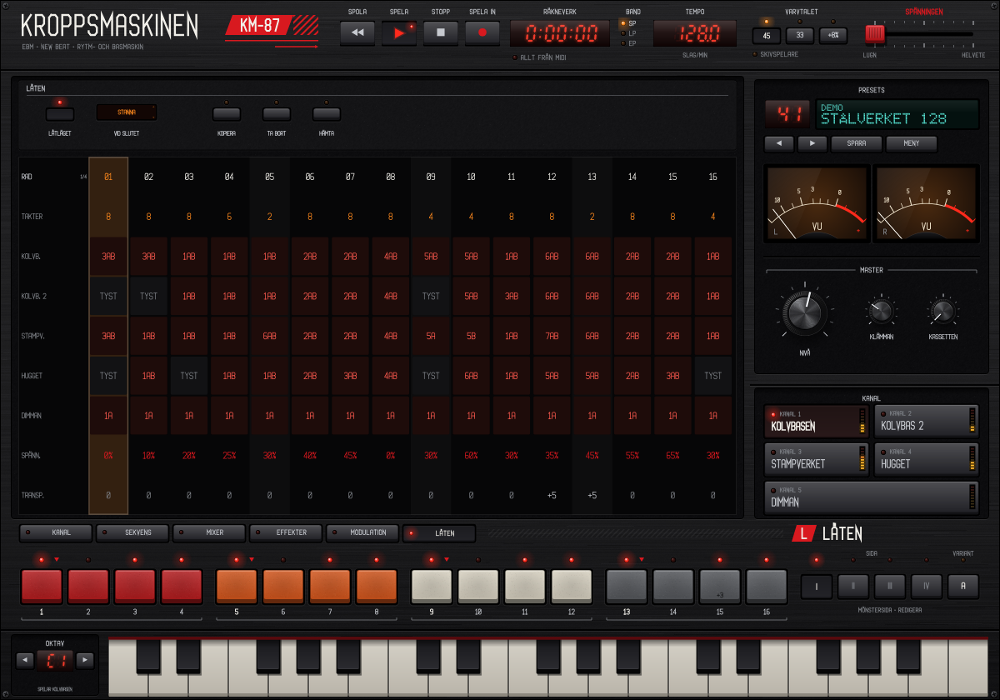

# Kroppsmaskinen

*Modell KM-87.* En groovebox för Electronic Body Music och New Beat. Instrument-plugin (VST3, AU, CLAP) och fristående app för macOS. Allt ljud är syntetiskt.

**Status: fas 0–3 klara och grind 0–3 godkända. Fas 4 – fabriksbandet, låtläget och manualen – är byggd och väntar på grind 4.** Se [PLAN.md](PLAN.md) för hela planen.

Det här finns:

- **Kolvbasen:** monofon sekvensbas. Två oscillatorer (sågtand som tonar över i puls), synk, sub, brus, ett 24 dB-ladderfilter eller ett tunnare 12 dB-filter, snabb filterenvelope, accent och glid.
- **Kolvbas 2:** samma motor som en egen kanal, med eget mönster och egen klang – eller **Följ Kolvbasen**: den spelar då Kolvbasens mönster, förskjutet 0–3 sextondelar och transponerat ±24 halvtoner. Två basar i lager är grunden i det tunga EBM-ljudet.
- **Stampverket:** tolv syntetiska ljud – bastrumma, två virvlar, handklapp, stängd och öppen hi-hat (den stängda tystar den öppna), cymbal, två tom, metall (städ), smäll (fabriksport) och kubjällra eller kantslag – i fem kit: **Åttaåtta**, **Niononio**, **Digital**, **Fabrik** och **Gjuteriet**. Gjuteriet är fysiskt modellerad metall: kroppar som slås an av en klubba och klingar i sina egna svängningsmoder – oljefat, plåt, kedja, hammare mot städ, bult, ringande rör, åskplåt, låga och höga rör, städ, spiralfjäder och klocka (eller spik i stället för kantslag). Spåren och MIDI-tonerna är desamma som i de andra kiten, så alla mönster går att spela på Gjuteriet.
- **Hugget:** stötar och leads, åtta röster. Sju lägen – **Orkesterstöt**, **Blåsstöt**, **Körstöt**, **Klockstöt**, **Synklead**, **Pulslead** och **FM-lead** – och ett **ackordminne** (moll, dur, kvint, oktav, moll 7, sus 4, moll 9), så att en enda rad i sekvensern ger fulla stötar.
- **Dimman** (fas 5): mattor och drön, tolv röster i stereo. Tre lägen – **Syntmatta** (tre svävande sågtänder och en fyrkant en oktav ned genom ett mjukt filter), **Kör** (formanter som glider från a över o till i) och **Drönmaskin** (ringmodulerade sågtänder, subsinus, långsam drift och svepande brus) – med ackordminnet, **Rörelse**, **Bredd**, **Vokal** och en **Ensemble** över hela kanalen. Dimman spelar ett eget mönster (hållna ackord med glid), eller håller grundtonen eller ackordet så länge sekvensern går i **drönläget**; drönet följer transponeringen och låtens rader.
- **Drivet** på varje kanal: rör, overdrive eller bitkross, med automatisk nivåkompensation.
- **Effekterna:** **Grindrummet** (gatad reverb: rummet stängs tvärt efter hålltiden), **Ekot** (synkat eko i BBD- eller bandläge, med ping-pong), **Svajet** (chorus i läge I, II och I+II), **Klämman** (busskompressor där bastrumman kan få resten att pumpa) och **Kassetten** (bandet sist i kedjan: svaj, fladder, tappningar, brus och mättnad; bandhastigheten SP, LP eller EP tar bort mer diskant). Grindrummet och Ekot matas från varje kanals sändningar. Kassetten är helt av när slitaget är noll och bandet går i SP.
- **Varvtalet:** New Beat-tricket – en 45-varvare spelad på 33 (eller 33 med pitchen uppe 8 %). *Musikaliskt* läge sänker tempo och tonhöjd och låter allt klinga längre; *Skivspelare* spelar hela maskinen långsammare, effekterna också. I en DAW följer tempot projektet och skivspelarläget blir musikaliskt.
- **Spänningen:** en makrospak som drar allt mot mer energi – hårdare accenter, kortare filtersvep, mer drive, mer rum, mer pump.
- **Modulationen:** två LFO:er (fria eller i takt, 4 takter – 1/16), två envelopes som startas av en vald kanal, modhjul, aftertouch och anslag, och sex kopplingar till filter, klang, pulsbredd, tonhöjd, Drivet, rummet, ekot och Spänningen.
- **MIDI-spel:** varje kanal kan spelas av inkommande MIDI i stället för av sekvensern (kanal 1 Kolvbasen, 2 Kolvbas 2, 3 Hugget, 4 Dimman, 10 Stampverket), så att Kroppsmaskinen kan användas som synt och trummaskin i en DAW. **ALLT FRÅN MIDI** (under räkneverket) tystar hela sekvensern på en gång. MIDI-läget följer inte med presets, så man kan byta ljud utan att sekvensern startar.
- **Stämningen:** mikrotonala stämningar för Kolvbasen, Kolvbas 2 och Hugget (trummorna rörs inte), i MIXER-vyns låda *Takt och master*. Inbyggda: **Liksvävande**, **Ren stämning**, **Pytagoreisk**, **Medeltonig** (kvartskommaton), **Werckmeister III**, makamerna **Rast** och **Bayati** (kvartstoner på tredje och sjunde, respektive andra steget), gamelanskalorna **Slendro** och **Pelog** (varje tangent går till närmaste ton i skalan, så att vanliga mönster blir gamelan), samt **24-TET** och **19-TET** (varje tangent ett steg). **Tonika** är tonen skalan utgår från – grundtonen eller en vald ton. **Egen (Scala)**: knappen **Scala…** läser in en `.scl`-skala och valfritt en `.kbm`-tangentkarta (tangenter markerade med x är tysta). Skalan sparas i projektet och i egna presets.
- **MIDI ut** (fas 5): sekvensernas toner som MIDI till en annan synt eller hårdvara, på kanal 1 Kolvbasen, 2 Kolvbas 2, 3 Hugget, 4 Dimman och 10 Stampverket. **MIDI UT** under transportknapparna: *Av*, *Med ljudet* eller *Bara MIDI* (de sekvenserade kanalerna tystnar). Glid går ut som legato, tysta kanaler skickar inget, och läget följer inte med presets. Se [Kroppsmaskinen i Reaper](docs/Kroppsmaskinen_i_Reaper.md), B7.
- **Taktverket:** sextondelar med gung, egen klocka eller DAW:ens transport, olika längd per kanal (polymeter), transponering från keyboardet.
- **Mönsterbanker:** 16 mönster per kanal, vart och ett med variant A och B. Varianten kan vara A, B eller A+B (växlar varannat varv). Byter du mönster medan sekvensern går tar det nya över på nästa takt.
- **Låtläget:** en låt med upp till 64 rader. Varje rad anger mönster och variant för alla fem kanalerna, vilka kanaler som är tysta, hur många takter raden spelas och – om man vill – Spänningen och en transponering. Låten följer DAW:ens position takt för takt, och sparas med presetet.
- **Mixern:** nivå, panorering, sändning till Grindrummet och Ekot, tyst och solo per kanal, och tyst per trumspår.
- **Fabriksbandet:** 43 presets – *Init* och 42 startpunkter i EBM, New Beat och Industri, var och en med flera mönster per kanal – och två demolåtar med hela arrangemanget i låtläget. Se [Fabriksbandet](#fabriksbandet).
- **VHS-panelen:** en svart hemelektroniklåda från 1987 med en tjock-TV i mitten och VHS-band ovanpå bilden. Skärmen visar vald kanal som en maskin i en vektorvärld (kolven, två kolvar, pressen, bilan), mixern som torn, effekterna som oscilloskop och modulationen som kurvor. Allt ritas i kod (`Source/ui/`), inklusive OSD-typsnittet och texturerna – inga bild- eller typsnittsfiler. Panelen kan visas i 60–160 % (MENY → Storlek, 85 % från början).



Fler vyer: `docs/panelen_sekvens.png`, `docs/panelen_stampverket.png`, `docs/panelen_gjuteriet.png`, `docs/panelen_dimman.png`, `docs/panelen_mixer.png`, `docs/panelen_effekter.png` och `docs/panelen_modulation.png`. Det godkända stilprovet ligger kvar i `docs/stilprov_vhs.png` och `docs/stilprov_detaljer.png`.

## Spela

Tryck **SPELA** i bandverket överst (den fristående appen; i en DAW följer sekvensern DAW:ens transport).

| Del | Vad den gör |
| --- | --- |
| **Bandverket** | SPOLA (börjar om från takt 1 och nollar räkneverket), SPELA, STOPP och SPELA IN (stegskrivning, se nedan). Under dem **MIDI UT** (*Av*, *Med ljudet*, *Bara MIDI*; följer inte med presets). **Räkneverket** visar speltiden, och under det sitter **ALLT FRÅN MIDI** (hela sekvensern tyst, alla kanaler spelas av inkommande MIDI; följer inte med presets). **Band** SP/LP/EP är Kassettens bandhastighet. **Tempo**: dra upp/ned (Skift = tiondelar), rulla, dubbelklicka för 125. **Varvtalet** 45/33/+8 % och **Skivspelare**. **Spänningen**: spaken. |
| **Kanalväljaren** | Under presets, i alla vyer (fem kanaler; Dimman på nedersta raden): väljer kanal för KANAL- och SEKVENS-vyn, stegraden och klaviaturen. Högerklick tystar kanalen. Stapeln visar nivån. |
| **Bildskärmen** | Uppe till höger på KANAL-sidan: vald kanal som en maskin i en vektorvärld. **Bandstyrka** Av / Lite / Mycket i MENY; Kassettens slitage sliter också bilden. |
| **Presets** | Numret och namnet (klicka på numret för listan), ◀ ▶, **SPARA** och **MENY** (presets, spara, bandstyrka, storlek och *Visa gränssnittets CPU*). Rör man ett reglage visar displayen namn och värde. VU-mätarna och mastern: **Nivå**, **Klämman** (tröskeln – medurs klämmer mer) och **Kassetten** (slitaget). |
| **Vyerna** | **KANAL**: en sida per kanal med bildskärmen uppe till höger och ljudets lådor runt och under den – oscillatorer, filter, envelope, Drivet – och lådan *Kanal* med Mönster, Variant, Längd, nivå, panorering, sändningar och MIDI-spel (värdet står under varje ratt). I Stampverket väljer man trumma med de tolv knapparna (som på en TR-maskin); lysdioderna blinkar när trummorna slår. Alla vyer är egna sidor, som i KrangBox, med stora reglage i lådor; vyknapparna ligger i listen under sidan och kanalväljaren under presets. **SEKVENS**: hela mönstret för vald kanal och sida, Mönster, Variant, Längd, Gung, **Kopiera A→B** och **Rensa**. **MIXER**: en remsa per kanal (fem) med fader, nivåstapel, panorering, sändningar, Drivet, tyst och solo, och Taktverket med mastern. **EFFEKTER**: Grindrummet, Ekot, Svajet, Klämman med reduktionsmätare och Kassetten. **MODULATION**: LFO:erna, envelopes med faders och de sex kopplingarna. **LÅTEN**: låtläget (se nedan). |
| **Stegraden** | Vald kanals mönster, sexton steg per sida. **I–IV** väljer sida (sidan följer spelhuvudet när mönstret är längre än 16 steg, utom en stund efter att man valt själv). **A/B** väljer vilken variant som ändras. I Stampverket ändras vald trumma. |
| **Klaviaturen** | Spelar vald kanal (Stampverket på kanal 10 enligt GM-kartan nedan); ◀ ▶ flyttar en oktav. Datorns tangentbord spelar också: **A W S E D F T G Y H U J K O L P** är C … D♯ från klaviaturens lägsta C, **Z** och **X** byter oktav och **mellanslag** startar och stoppar (klicka i panelen först, så att den har tangentbordet; i en DAW kan värden behöva släppa igenom tangenterna till pluginet). |

Reglagen: dra upp/ned (Skift = fint), rulla, dubbelklicka för grundvärdet. Väljarna: klick = nästa, Skift-klick = förra, rulla, högerklick = lista.

Stegraden och SEKVENS-vyn:

| Var | Gör |
| --- | --- |
| Trummor, klick | av → slag → accent |
| Trummor, Skift-klick | ratchet: 1, 2, 3 eller 4 slag inom steget |
| Trummor, Alt-klick | chans: 100, 75, 50 eller 25 % |
| Trummor, klick på namnet (SEKVENS) | väljer trumma för stegraden |
| Bas, klick | av → ton → accent (i SEKVENS: klick på en annan rad flyttar tonen dit) |
| Bas, dra upp/ned eller rulla | tonen, ±12 halvtoner från grundtonen |
| Bas, högerklick | glid: tonen hålls och glider in i nästa |
| Bas, Alt-klick | oktav: 0 → upp → ned |
| Bas, Skift-klick | tonlängd: ¼, ½, ¾, 1, 1½, 2, 3 eller 4 steg |

**SPELA IN** (stegskrivning): när sekvensern står still skriver klaviaturen in en ton (eller ett trumslag) vid markören, som blinkar orange i stegraden och flyttas fram ett steg; klicka på ett steg för att flytta markören. Medan sekvensern går hamnar tonen i steget som spelas. Hårt anslag (nederkanten av tangenten) ger accent.

Om ljudkortet inte går i den takt det uppger – till exempel Bluetooth-lurar i samtalsläge (16 kHz), som får både tempo och tonhöjd att bli fel – visar presetdisplayen en orange varning. Välj då 44,1 eller 48 kHz under *Options*.

När sekvensern står still spelar keyboardet Kolvbasen (MIDI-kanal 2 spelar Kolvbas 2, kanal 3 Hugget och kanal 4 Dimman). Modhjulet (CC 1) och aftertouch går till modulationen. När den går flyttar en tangent alla tongångar (räknat från **Grundton**; Hugget och Dimman spelar två oktaver över, plus sin **Oktav**). MIDI-kanal 10 spelar trummorna enligt GM-kartan:

| Spår | Ton | Spår | Ton |
| --- | --- | --- | --- |
| Bastrumma | 36 C2 | Cymbal | 49 C♯3 |
| Virvel | 38 D2 | Tom låg | 41 F2 |
| Virvel 2 | 40 E2 | Tom hög | 48 C3 |
| Handklapp | 39 D♯2 | Metall | 56 G♯3 |
| Hi-hat | 42 F♯2 | Smäll | 54 F♯3 |
| Öppen hi-hat | 46 A♯2 | Kubjällra / kantslag | 37 C♯2 |

## Manualer

- **[Bygga en låt i Kroppsmaskinen](docs/Bygga_en_lat.md)** – mönster, variationer, låtläget och ett exempel från början till slut.
- **[Kroppsmaskinen i Reaper](docs/Kroppsmaskinen_i_Reaper.md)** – bygga låten i Kroppsmaskinen och spela in, mixa och rendera i Reaper, eller använda bas, trummor och stötar som instrument i låtar som görs i Reaper (MIDI-spel per kanal).

## Ett spår på en timme

1. **Välj en startpunkt.** Bläddra med ◀ ▶ under presetdisplayen (eller klicka på numret för listan) och tryck **SPELA**. Varje preset i EBM, New Beat och Industri är ett eget ljud med färdiga mönster: mönster **1** är grundgrooven (A och B växlar, B är variationen eller fillen), **2** är refrängen eller kontrasten, **3** ett intro eller en gles del och **4** en trumfill eller ett uppbygge. (De sju första presetsen från fas 0–2 följer inte riktigt den planen; där är mönster 1 det viktiga.)
2. **Lyssna på delarna.** Byt mönster med **Mönster** i KANAL-sidans låda *Kanal* (klick = nästa, rulla, högerklick = lista) eller i **SEKVENS**-vyn; bytet sker på nästa takt. Högerklick på en kanal tystar den. Prova **Spänningen** och **Varvtalet**.
3. **Gör det till ditt.** Ändra ljudet i **KANAL**-vyn och mönstren i stegraden eller i **SEKVENS** (se tabellen nedan). Spara med **SPARA**.
4. **Bygg låten.** Gå till **LÅTEN**. Klicka på **+** för första raden, ställ in mönstren med panelen och tryck **HÄMTA** – raden får kanalernas mönster, varianter och tystnad. Ställ takterna (dra i siffran). Klicka på **+** igen för nästa rad (den börjar som en kopia), ändra, och så vidare. Slå på **LÅTLÄGET** och tryck **SPOLA** och **SPELA**. Spänningen per rad ger uppbyggen; en transponering per rad ger tonartsbyten.
5. **Spela in i DAW:en.** Lägg Kroppsmaskinen på ett instrumentspår. Låten följer DAW:ens takt (takt 1 = låtens första rad), så det räcker att trycka play. Eller spela in den fristående appens utgång.

### Ljudbanken och Lås mönstren

Kroppsmaskinen ska fungera även utanför fabriksbandets låtar, så ljuden kan bytas för sig:

- **Ljudbanken** (överst i KANAL-vyn: **LJUD** ◀ namn ▶ **SPARA**) byter bara vald kanals klang – oscillatorer, filter, envelopes och Drivet, eller Stampverkets kit och trummornas stämning, klang och nivå, eller Huggets läge, ackord och envelope. Mönster, låt, tempo och mixen (nivå, panorering, sändningar) står kvar. Klicka på namnet för listan. Basljuden går att lägga på både Kolvbasen och Kolvbas 2. Fabriksljuden kommer från fabriksbandet (79 basljud, 40 trumljud och 37 ljud för Hugget, sorterade efter presetets kategori); egna ljud sparas med **SPARA** under *Egna*.
- **Lås mönstren** (MENY) gör att presets bara byter ljudet – klang, effekter, modulation och mix – och lämnar mönster, låt, tempo, gung, grundton, Varvtalet och kanalernas mönsterval som de är. Presetdisplayen visar *(LÅSTA MÖNSTER)* så länge det är på. Så kan en egen låt provas med alla fabriksbandets ljud.

Demolåtarna *Stålverket 128* och *Antwerpen 110* (kategorin Demo) visar ett helt arrangemang i låtläget – öppna dem och titta i **LÅTEN**.



### Låtläget i detalj

| Var | Gör |
| --- | --- |
| **LÅTLÄGET** | Låten styr mönster, varianter och tystnad. Av: panelens Mönster och Variant gäller, som vanligt. |
| **Vid slutet** | *Loopa* börjar om från första raden; *Stanna* tystnar efter sista raden. |
| Radnumret | Väljer rad (orange = raden som spelas). **KOPIERA**, **TA BORT** och **HÄMTA** verkar på vald rad. |
| **+** | Lägger till en rad sist: en kopia av den sista, eller panelens mönster om låten är tom. |
| Takter | Klick = +1, högerklick (eller Alt-klick) = −1, eller dra/rulla (1–64); dubbelklick ger 4. |
| Kanalernas rutor | En rad per kanal, Dimman sist. Dra eller rulla för mönster 1–16, klicka för variant A → B → A+B, högerklick tystar kanalen på raden. |
| Spänn. | Spänningen för raden, 0–100 %: klick = +10 %, högerklick (eller Alt-klick) = −10 %, dra/rulla i steg om 5 %. Från "–" ger ett klick 0 %, och under 0 blir det "–" igen (rör inte spaken); dubbelklick ger "–". |
| Transp. | Transponerar Kolvbasen, Kolvbas 2 och Hugget ±24 halvtoner: klick = +1, högerklick (eller Alt-klick) = −1, dra/rulla; dubbelklick ger 0. |
| Rubrikkolumnen | Klick eller rullning byter sida (16 rader per sida, fyra sidor). Sidan följer raden som spelas. |

Låtens rader byter på taktgränsen; efter ett hopp eller en start mitt i en takt gäller den rad som platsen hör till. Mönster i A+B-läge växlar varannan takt räknat från låtens början, så rader med ett jämnt antal takter håller A och B i fas.

## Fabriksbandet

| Kategori | Preset | Idé |
| --- | --- | --- |
| Grund | Init | En bastrumma och en ton – börja från noll |
| EBM | Kolv 125 | Sextondelsbas med oktavhopp (grind 0) |
| EBM | EBM 128 | Två basar i lager: mörk botten och samma gång en oktav upp, överstyrd |
| EBM | Marsch 120 | Marschtakt, tung bas (grind 1) |
| EBM | Fabriksgolv 125 | Hela maskinen: lager av basar, stötar, gatad virvel (grind 2) |
| EBM | Paroll 132 | Snabbt och hårt, körstötar |
| EBM | Valsverk 124 | Bas i treor, Kolvbas 2 en oktav upp och 3/16 sent, kvintstötar |
| EBM | Smedjan 118 | Pulsbas med halvtonsgnissel, städ, synkad Kolvbas 2, enorm gatad virvel |
| EBM | Stålpress 130 | DAF-aktiga sågtandssextondelar i två takter, motstämma på 12 steg, blåsstötar |
| EBM | Signalfabrik 126 | FM-melodi över lagrad bas, ping-pong-eko på 3/16 |
| EBM | Kontrollrum 122 | Tre mot fyra i basen, kantslag, sus4-körstötar, drönande Kolvbas 2 |
| EBM | Ångvissla 133 | Snabb, bitkrossad frygisk bas, pumpande kompressor, ekande orkesterstötar |
| EBM | Kadens 116 | Gung, gummiaktig glidbas, plockade pulsackord, pulsleadkrok |
| EBM | Löpande band 129 | Arpeggiobas, Kolvbas 2 en kvint upp och en åttondel sent, klockackord |
| EBM | Trumslagare 121 | Tom i stället för hi-hat, sub en oktav ned, synklead |
| New Beat | New Beat 112 | Långsam, tung, belgisk (grind 1) |
| New Beat | Svart skiva 33 | 145 BPM på 33 varv med pitchen uppe: 116 BPM |
| New Beat | Syrabad 108 | Syrabas i Kolvbas 2 över en offbeat-sub, kubjällra |
| New Beat | Nålen 33 | 152 BPM på 33 varv (113): lagrad EBM-bas som faller en kvart |
| New Beat | Nattskift 110 | Klassisk studsande oktavbas, Kolvbas 2 en sextondel sent, blåsstötar |
| New Beat | Svartrock 104 | Överstyrd kvint-"gitarr", sub en oktav ned, slitet LP-band |
| New Beat | Kubjällra 115 | Kubjällran leder, blåsstötar i dur, plockad Kolvbas 2 |
| New Beat | Mörkrum 100 | Enorm gatad virvel, liggande körackord, frygisk glidbas |
| New Beat | Plus åtta 33 | 140 BPM på 33 + 8 % i skivspelarläget (112): klockor i kvinter med eko |
| New Beat | Gummiband 107 | Glidbas som öppnas av en LFO på halvnoter, brusskakare, pulslead |
| New Beat | Bältesdrift 106 | Tung lagrad sextondelsbas, fallande orkesterstötar, Fabrik-kitet |
| New Beat | Rökmaskin 113 | Chorus, långt bandeko, klockor, Kolvbas 2 en åttondel sent och åt höger |
| New Beat | Kassettkopia 109 | Slitet EP-band, synklead, Kolvbas 2 på 12 steg |
| Industri | Slagverk 96 | Metallslagverk, brusdrön, gonggong |
| Industri | Pressluft 142 | Bitkross överallt, bastrumvirvlar i sextondelar, dykande stötar |
| Industri | Monument 88 | Långsam marsch, pukor, virvelvirvlar, orgelkvintbas |
| Industri | Ånghammare 108 | Arpeggion av stålklockor, staccatobas med förslag |
| Industri | Kraftverk 120 | Liggande brum med LFO, ångstötar i Kolvbas 2, drivande turbin |
| Industri | Rost 84 | Slamglidbas, Smäll som virvel, slitet EP-band |
| Industri | Gnistor 148 | Snabb trestegsbas, FM-lead svept av en sågtands-LFO |
| Industri | Gjuteri 112 | Synkad skrikbas över en sub, hård pump |
| Industri | Larmklocka 128 | Siren (LFO på Huggets tonhöjd) över studsande bas |
| Industri | Betong 100 | Halvtid, jättelik gatad virvel på trean, sub plus kvintgrus |
| Industri | Signalstörning 134 | Chans och ratchets i varje spår, slumpad LFO på filtret, klockblipp |
| Industri | Skyddsrum 72 | Mörkt och stilla: drön i kvinter, kör, djup metall, långt bandeko |
| Demo | Stålverket 128 | Demolåt, EBM i e-moll: 18 rader, 107 takter (3:20), bryggan en kvart upp |
| Demo | Antwerpen 110 | Demolåt, New Beat i g-moll med gung: 18 rader, 97 takter (3:31) |
| Industri | Dimbank 96 | Fas 5: Dimmans drönmaskin håller ett mollackord över en långsam gång på Gjuteriets metall |
| New Beat | Kalla salar 112 | Fas 5: Dimmans körmattor, två ackord som byter varannan takt |
| EBM | Skiftbyte 124 | Fas 5: syntmattan i moll 7-stötar och hållna ackord över en rak gång |

## Bygga lokalt

Samma verktyg som för KrangBox: macOS 14+, Xcode 15+, CMake 3.22+ (och gärna Ninja).

```sh
cmake -B build -G Xcode
cmake --build build --config Release --target Kroppsmaskinen_All
```

Snabbare under utveckling:

```sh
cmake -B build-dev -G Ninja -DCMAKE_BUILD_TYPE=Debug -DCMAKE_OSX_ARCHITECTURES=arm64
cmake --build build-dev --target Kroppsmaskinen_Standalone
open build-dev/Kroppsmaskinen_artefacts/Debug/Standalone/Kroppsmaskinen.app
```

JUCE 8.0.4 och clap-juce-extensions hämtas från GitHub första gången. Har du redan byggt KrangBox kan du återanvända dess kopia:

```sh
cmake -B build -G Xcode \
  -DFETCHCONTENT_SOURCE_DIR_JUCE=../krang-box/build/_deps/juce-src \
  -DFETCHCONTENT_SOURCE_DIR_CLAP-JUCE-EXTENSIONS=../krang-box/build/_deps/clap-juce-extensions-src
```

### Byggmål

| Mål | Bygger |
| --- | --- |
| `Kroppsmaskinen_All` | VST3, AU, CLAP och den fristående appen |
| `Kroppsmaskinen_Standalone` | `Kroppsmaskinen.app` |
| `KMRender` | Renderingstestet och lyssningsfilerna (se nedan) |
| `KMSnapshot` | Ritar panelen till PNG: `KMSnapshot fil.png [skala] [vy 1–6] [kanal 1–4] [preset] [id=värde …]` (skala 2 = Retina); efter presetet kan parametrar sättas som `id=värde`, t.ex. `km_midi_alla=1`. `--klicktest` är hela klicktestet: varje reglage ska ändra just sin egen parameter (och ingen annan), alla parametrar ska nås från panelen, allt i alla vyer klickas (letar krascher och jassert) och låtvyns klick kontrolleras – OK/FEL och felkod. `--prestanda [skala] [sekunder]` (även `--tid`) mäter panelens kostnad, `--manual [katalog]` ritar manualens bilder i `docs/`. Delarna går också att köra var för sig: `--panel-parametrar`, `--panel-klick`, `--lat-klick`. `--skarm katalog` och `--skarm-tid` ritar och mäter bildskärmen för sig; `--stilprov fil.png` och `--stilprov-detaljer fil.png` ritar stilprovet |

### Installera i din DAW

```sh
cp -R build/Kroppsmaskinen_artefacts/Release/VST3/Kroppsmaskinen.vst3 ~/Library/Audio/Plug-Ins/VST3/
cp -R build/Kroppsmaskinen_artefacts/Release/AU/Kroppsmaskinen.component ~/Library/Audio/Plug-Ins/Components/
mkdir -p ~/Library/Audio/Plug-Ins/CLAP
cp -R build/Kroppsmaskinen_artefacts/Release/CLAP/Kroppsmaskinen.clap ~/Library/Audio/Plug-Ins/CLAP/
```

## Renderingstest och grindarna

```sh
cmake --build build --config Release --target KMRender
./build/KMRender_artefacts/Release/KMRender --test renders
```

KMRender kontrollerar mönsterformatet (även inläsning av lägen från fas 0), alla 65 ljud för sig (Kolvbasen i båda filtren och med synk, Kolvbas 2, och tolv trummor i fem kit), att Taktverket slår exakt på stegen (även efter tio minuter, med egen klocka och med DAW-transport), att ett nytt mönster tar över på nästa takt, tyst och solo, att Kolvbas 2 som följer låter exakt som Kolvbasen, att Drivet håller nivån, alla fabrikspresets, 40 slumpade ytterlägen, tempot genom JUCE:s AudioProcessorPlayer (samma väg som den fristående appen) i 44,1, 48 och 96 kHz med olika blockstorlekar, Huggets sju lägen, att Grindrummet stänger, att Ekot kommer i takt, att Klämman pumpar, att Varvtalet sänker tempo och tonhöjd lika mycket i båda lägena, att Spänningen håller nivån, att modulationen hörs, att Kassetten är helt av utan slitage men håller nivån med fullt slitage, att låtläget byter mönster och tystnad takt för takt (Loopa och Stanna) att demolåtarna låter rad för rad hela vägen (`renders/demo_*.wav`) och att ljudbanken bara byter klangen, att alla 166 fabriksljud låter rent och att Lås mönstren behåller mönster och tempo, och att en kanal med MIDI-spel tystnar i sekvensern och spelas av MIDI-tonerna medan sekvensern går (och att Kolvbas 2 som följer tystnar med den), och att Allt från MIDI tystar allt och står kvar vid presetbyte, att stämningarna stämmer (tabellerna, Scala-filer med tangentkarta och Kolvbasen och Hugget i Rast) och att Gjuteriets moder hamnar på rätt frekvens, följer Stämning och Klang och att kedjan rasslar, stämningen i cent i bas, mellanläge och diskant (Kolvbasen och Hugget, ±3 cent), klick (tyst och solo mitt i en ton, röststöld i Hugget, upprepad ton och programbyte medan sekvensern går) och CPU (hela maskinen under 25 % av en kärna), och Dimman (tre lägen, drönläget, mönster i låten och stämningen) och MIDI ut (kanalerna, på stegen, släppta toner, bara MIDI, tysta kanaler, drönet och glid som legato). Den skriver antalet kontroller sist (178 i dag). Utan argument visar verktyget sin hjälp. `KMRender --trummor katalog [kit]` skriver varje trumma i varje kit för sig, med nivåerna. `KMRender --kanaler katalog [namn]` spelar varje presets mönster 1–4 för sig och varje kanal solo, med nivåerna utskrivna. Den avslutar med felkod om något går fel, så CI blir rött.

**Grind 0 (godkänd):** `renders/grind0_kolv125.wav` (och `_bas`, `_trummor`).

**Grind 2:** ett helt spår på 3–4 minuter i Reaper, bara med Kroppsmaskinen och utan externa effekter. *Fabriksgolv 125*, *Paroll 132* och *Svart skiva 33* är startpunkter; mönster byts med automation på kanalernas **Mönster** (det nya mönstret tar över på nästa takt). Huggets lägen finns som `renders/hugget_*.wav`.

**Grind 3 (godkänd):** VHS-panelen. Kraven: under CPU-målet (< 3 % av en kärna på en M1 i 100 %), alla parametrar nåbara och grind 2-låten byggbar utan DAW:ens generiska vy. Att mäta på Macen: MENY → *Visa gränssnittets CPU* visar meddelandetrådens processortid (medel över två sekunder) i presetdisplayen, med sekvensern igång. `KMSnapshot --klicktest` ska gå igenom (körs i CI).

**Grind 4:** någon som inte har byggt maskinen gör ett spår på en timme med bara fabriksbandet och manualen ovan ([Ett spår på en timme](#ett-spår-på-en-timme)).

**Grind 1 (godkänd):** tre loopar med bara bas och trummor, åtta takter var: `renders/grind1_ebm_128.wav`, `grind1_marsch_120.wav` och `grind1_new_beat_112.wav`. Varje kit finns som `renders/kit_*.wav` (alla tolv ljud efter varandra). Stilprovet granskas i `docs/stilprov_vhs.png`.

## Testlåtarna i Reaper

`Reaper/Stalverket.RPP` och `Reaper/Antwerpen.RPP` är demolåtarna: ett spår med Kroppsmaskinen och presetet, tempot och längden – hela arrangemanget ligger i pluginets låt (låtläget), så projekten har ingen automation.


`Reaper/Fabriksgolv.RPP` är grind 2-låten uppsatt i Reaper: ett spår med Kroppsmaskinen och presetet *Fabriksgolv 125* (med fler mönster), 112 takter i 125 BPM (3:35). Arrangemanget ligger som automation på pluginet – **Mönster** och **Tyst** för varje kanal och **Spänningen** – och en MIDI-region på spåret transponerar basgångarna en kvart upp i takt 57–64.

| Takt | Del |
| --- | --- |
| 1–8 | Intro: bastrumma och hi-hat |
| 9–16 | Kolvbasen kommer in |
| 17–32 | Kolvbas 2 och Hugget |
| 33–40 | Mer rörelse i basen och stötarna, Spänningen 30 % |
| 41–48 | Break: halvtidsbas och hi-hat, Spänningen byggs upp |
| 49–72 | Fullt (transponerat i takt 57–64) |
| 73–80 | Avbrott utan stötar |
| 81–96 | Fullt igen, Spänningen 70 % |
| 97–112 | Utklingning: kanalerna försvinner en i taget |

Projekten byggs av skriptet, som också kan rendera låtarna utan Reaper:

```sh
python3 tools/reaper/gor_reaper_projekt.py build/KMRender_artefacts/Release/KMRender Reaper --render
```

Reaper känner igen pluginet på ett tal och ett GUID. Skriptet läser talet ur Reapers pluginlista när det körs på en Mac där Kroppsmaskinen är inläst i Reaper. Om Reaper säger att pluginet saknas när projektet öppnas: kör skriptet ovan på Macen (efter att Reaper har hittat pluginet), så skrivs projektet om med rätt tal.

## Struktur

| Sökväg | Innehåll | Ursprung |
| --- | --- | --- |
| `Source/dsp/Grund.h` | Byggstenar: polyBLEP, TPT-filter, DC-spärr, mättnad, slump | Ny |
| `Source/dsp/Kolvbasen.h` | Sekvensbasen (både Kolvbasen och Kolvbas 2): oscillatorer, synk, ZDF-ladder och 12 dB-filter, envelopes, accent, glid | Utgår från `Basmalen.h` |
| `Source/dsp/Stampverket.h` | Trummorna: recepten för tolv ljud i fem kit, trumrösten med Gjuteriets fysiska modellering (moder, klubba, kedja, fjäder) och spårens fasta ordning | Ny |
| `Source/dsp/Dimman.h` | Dimman: mattor och drön, tolv röster, tre lägen och ensemblen | Ny |
| `Source/dsp/Stamning.h` | Stämningen: inbyggda skalor, Scala-filer (`.scl`, `.kbm`) och tabellen från tangent till tonhöjd | Ny |
| `Source/dsp/Hugget.h` | Stötar och leads: sju lägen, åtta röster, ackordminnet | Ny |
| `Source/dsp/Effekter.h` | Grindrummet, Ekot, Svajet, Klämman och Kassetten | Ny |
| `Source/dsp/Modulation.h` | LFO:er, envelopes och kopplingarna | Utgår från `Modulation.h` |
| `Source/dsp/Drivet.h` | Distorsionen per kanal: rör, overdrive (2x översamplat), bitkross, nivåkompensation | Utgår från `KrangDistortion.h` |
| `Source/dsp/Motor.h` | Kopplar ihop Taktverket, kanalerna, mönsterbankerna, mixern, effekterna, Spänningen, Varvtalet (musikaliskt), modulationen och toppbegränsaren | Ny |
| `Source/takt/Monster.h` | Trummönstret (12 spår), tonmönstret, textformatet och mönsterbankerna | Utgår från `Stegverket.h` och `TonStegverket.h` |
| `Source/takt/Laten.h` | Låten: raderna, textformatet och platsen i låten | Ny |
| `Source/takt/Taktverket.h` | Klockan: sextondelar, gung, DAW-synk, egen klocka | Utgår från `Stegverket.h` |
| `Source/Parameters.h` | Parameterträdet – `km_<kanal>_<vad>` | Ny |
| `Source/presets/` | Fabriksbandet, Ljudbanken (`.km87ljud`) och PresetManager (`.km87`-filer, formatversion 3: mönster och låt sparas med presetet) | Utgår från KrangBox |
| `Source/ui/ValueFormat.h` | Värdeformatet för rattarna | Kopia från KrangBox |
| `Source/ui/stil/` | VHS-panelens ritverktyg: palett, texturer, linjeskrift, OSD-typsnitt, hårdvara, skärm, bandlager och stilprovet | Ny |
| `Source/ui/vhs/` | VHS-panelen: `Panel.h` (sektionerna, vyerna, den cachade bakgrunden och timern), `Reglage.h` (ratt, knapp, väljare, spak, sjusegment), `Stegrad.h`, `Sekvens.h`, `Klaviatur.h`, `Bildskarm.h` och `Scener.h` (den animerade skärmen och bandlagret), `LatVy.h` (LÅTEN-vyn), `SkarmData.h` och `PanelLage.h` | Ny |
| `Source/PluginProcessor.*` | Processorn: parametrar, mönster, presets och Varvtalets skivspelarläge (varispeed) | Ny |
| `Source/PluginEditor.*` | Editorn: VHS-panelen i vald storlek (60–160 %) | Ny |
| `tools/KMRender.cpp` | Renderingstest (`--test`) och lyssningsfiler (`--trummor`, `--kanaler`); `--state`, `--parametrar` och `--projekt` för Reaper-skriptet | Ny |
| `tools/reaper/gor_reaper_projekt.py` | Bygger testlåten som Reaper-projekt (och JSON för `KMRender --projekt`) | Utgår från KrangBox |
| `Reaper/` | Testlåtarna: `Fabriksgolv`, `Stalverket` och `Antwerpen` (`.RPP` och `.json`) | Ny |
| `tools/KMSnapshot.cpp`, `tools/SkarmProv.h` | Ritar panelen, skärmen, stilprovet och manualbilderna (`--manual`) till PNG; mäter panelen och skärmen (`--prestanda`); klicktestet (`--klicktest`) | Ny |
| `.github/workflows/` | macOS-bygge, renderingstest, panelbilder och panelkontroller, pluginval | Utgår från KrangBox |

Parameter-ID:n bytte namn mellan fas 0 och fas 1 (till `km_<kanal>_<vad>`). Från version 1.0 får de aldrig ändras igen.

Filer som är kopior av KrangBox får inte glida isär i onödan: rättningar förs över för hand tills ett gemensamt bibliotek eventuellt byggs (fas 5).

## Licens

GNU Affero General Public License v3.0 – se [LICENSE](LICENSE). Kroppsmaskinen använder JUCE under dess AGPLv3-licens.
