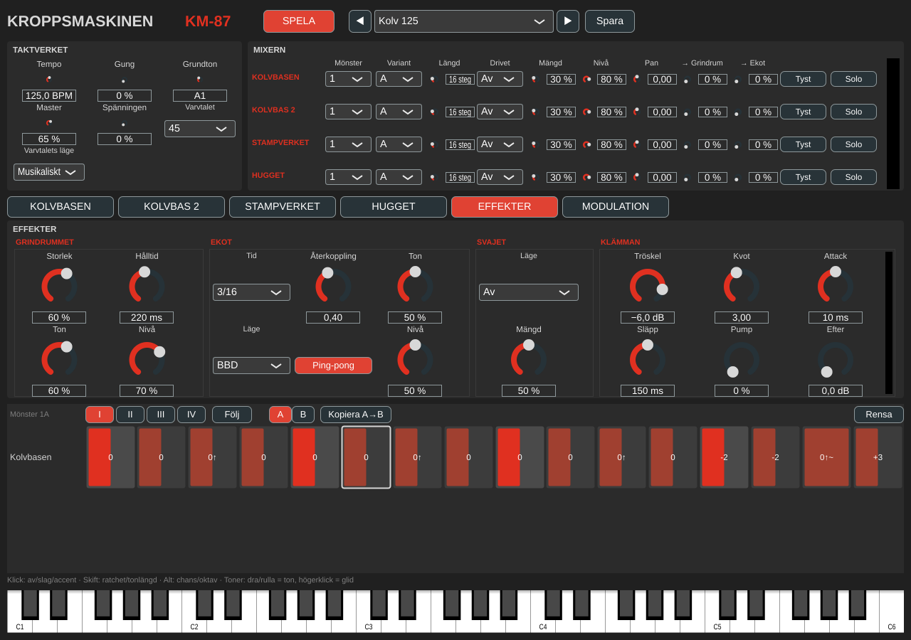
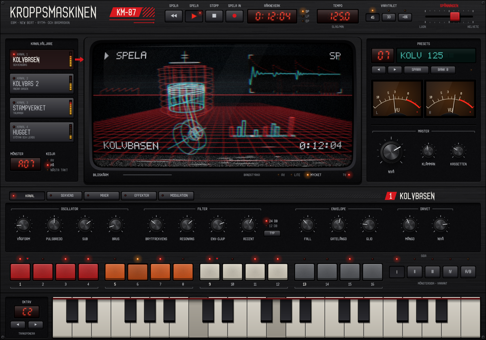

# Kroppsmaskinen

*Modell KM-87.* En groovebox för Electronic Body Music och New Beat. Instrument-plugin (VST3, AU, CLAP) och fristående app för macOS. Allt ljud är syntetiskt.

**Status: fas 0–2 klara, grind 0–2 och stilprovet godkända. Nästa: fas 3, VHS-panelen.** Se [PLAN.md](PLAN.md) för hela planen.

Det här finns:

- **Kolvbasen:** monofon sekvensbas. Två oscillatorer (sågtand som tonar över i puls), synk, sub, brus, ett 24 dB-ladderfilter eller ett tunnare 12 dB-filter, snabb filterenvelope, accent och glid.
- **Kolvbas 2:** samma motor som en egen kanal, med eget mönster och egen klang – eller **Följ Kolvbasen**: den spelar då Kolvbasens mönster, förskjutet 0–3 sextondelar och transponerat ±24 halvtoner. Två basar i lager är grunden i det tunga EBM-ljudet.
- **Stampverket:** tolv syntetiska ljud – bastrumma, två virvlar, handklapp, stängd och öppen hi-hat (den stängda tystar den öppna), cymbal, två tom, metall (städ), smäll (fabriksport) och kubjällra eller kantslag – i fyra kit: **Åttaåtta**, **Niononio**, **Digital** och **Fabrik**.
- **Hugget:** stötar och leads, åtta röster. Sju lägen – **Orkesterstöt**, **Blåsstöt**, **Körstöt**, **Klockstöt**, **Synklead**, **Pulslead** och **FM-lead** – och ett **ackordminne** (moll, dur, kvint, oktav, moll 7, sus 4, moll 9), så att en enda rad i sekvensern ger fulla stötar.
- **Drivet** på varje kanal: rör, overdrive eller bitkross, med automatisk nivåkompensation.
- **Effekterna:** **Grindrummet** (gatad reverb: rummet stängs tvärt efter hålltiden), **Ekot** (synkat eko i BBD- eller bandläge, med ping-pong), **Svajet** (chorus i läge I, II och I+II) och **Klämman** (busskompressor där bastrumman kan få resten att pumpa). Grindrummet och Ekot matas från varje kanals sändningar.
- **Varvtalet:** New Beat-tricket – en 45-varvare spelad på 33 (eller 33 med pitchen uppe 8 %). *Musikaliskt* läge sänker tempo och tonhöjd och låter allt klinga längre; *Skivspelare* spelar hela maskinen långsammare, effekterna också. I en DAW följer tempot projektet och skivspelarläget blir musikaliskt.
- **Spänningen:** en makrospak som drar allt mot mer energi – hårdare accenter, kortare filtersvep, mer drive, mer rum, mer pump.
- **Modulationen:** två LFO:er (fria eller i takt, 4 takter – 1/16), två envelopes som startas av en vald kanal, modhjul, aftertouch och anslag, och sex kopplingar till filter, klang, pulsbredd, tonhöjd, Drivet, rummet, ekot och Spänningen.
- **Taktverket:** sextondelar med gung, egen klocka eller DAW:ens transport, olika längd per kanal (polymeter), transponering från keyboardet.
- **Mönsterbanker:** 16 mönster per kanal, vart och ett med variant A och B. Varianten kan vara A, B eller A+B (växlar varannat varv). Byter du mönster medan sekvensern går tar det nya över på nästa takt.
- **Mixern:** nivå, panorering, sändning till Grindrummet och Ekot, tyst och solo per kanal, och tyst per trumspår.
- **Fabriksbandet:** *Init*, *Kolv 125* (grind 0), grind 1-looparna *EBM 128*, *Marsch 120* och *New Beat 112*, och hela maskinen i *Fabriksgolv 125*, *Paroll 132* och *Svart skiva 33* (145 BPM på 33 varv med pitchen uppe: 116 BPM).
- **Ett grått gränssnitt** med standardrattar, bara för att kunna spela. VHS-panelen kommer i fas 3 – stilprovet finns redan (se nedan).



## Stilprovet för VHS-panelen

Så här ska Kroppsmaskinen se ut från fas 3: en svart hemelektroniklåda från 1987 med en tjock-TV i mitten, och VHS-band ovanpå bilden. Allt ritas i kod (`Source/ui/stil/`), inklusive OSD-typsnittet och texturerna – inga bild- eller typsnittsfiler.



Närbilder av rattar, stegknappar, displayer, typsnittet och skärmen med och utan bandlagret finns i `docs/stilprov_detaljer.png`.

## Spela

Tryck **SPELA** i den fristående appen. Längst ned till höger under rutnätet visas samplingsfrekvensen, blockstorleken, det uppmätta tempot och hur snabbt ljudet behandlas jämfört med realtid (ska vara 1,00×). Raden blir röd om ljudkortet inte går i den takt det uppger – till exempel Bluetooth-lurar i samtalsläge (16 kHz), som får både tempo och tonhöjd att bli fel. Välj då 44,1 eller 48 kHz under *Options*, eller låt Macens ljudingång vara den inbyggda mikrofonen så att lurarna stannar i musikläge. I en DAW följer sekvensern DAW:ens transport. Flikarna **KOLVBASEN**, **KOLVBAS 2**, **STAMPVERKET** och **HUGGET** väljer vilken kanal som visas, **EFFEKTER** och **MODULATION** visar effekterna och modulationen; rutnätet visar kanalens valda mönster (Mönster i mixern) och variant A eller B.

Stegrutnätet:

| Var | Gör |
| --- | --- |
| Trummor, klick | av → slag → accent |
| Trummor, Skift-klick | ratchet: 1, 2, 3 eller 4 slag inom steget |
| Trummor, Alt-klick | chans: 100, 75, 50 eller 25 % |
| Bas, klick | av → ton → accent |
| Bas, dra upp/ned eller rulla | tonen, ±12 halvtoner från grundtonen |
| Bas, högerklick | glid: tonen hålls och glider in i nästa |
| Bas, Alt-klick | oktav: 0 → upp → ned |
| Bas, Skift-klick | tonlängd: ¼, ½, ¾, 1, 1½, 2, 3 eller 4 steg (syns som stapelns bredd) |
| I–IV | sidan som visas; **Följ** låter sidan följa uppspelningen |
| A / B | vilken variant som visas och ändras; **Kopiera A→B** gör B till en kopia av A |

När sekvensern står still spelar keyboardet Kolvbasen (MIDI-kanal 2 spelar Kolvbas 2 och kanal 3 Hugget). Modhjulet (CC 1) och aftertouch går till modulationen. När den går flyttar en tangent alla tongångar (räknat från **Grundton**; Hugget spelar två oktaver över, plus sin **Oktav**). MIDI-kanal 10 spelar trummorna enligt GM-kartan:

| Spår | Ton | Spår | Ton |
| --- | --- | --- | --- |
| Bastrumma | 36 C2 | Cymbal | 49 C♯3 |
| Virvel | 38 D2 | Tom låg | 41 F2 |
| Virvel 2 | 40 E2 | Tom hög | 48 C3 |
| Handklapp | 39 D♯2 | Metall | 56 G♯3 |
| Hi-hat | 42 F♯2 | Smäll | 54 F♯3 |
| Öppen hi-hat | 46 A♯2 | Kubjällra / kantslag | 37 C♯2 |

## Bygga lokalt

Samma verktyg som för KrangBox: macOS 14+, Xcode 15+, CMake 3.22+ (och gärna Ninja).

```sh
cmake -B build -G Xcode
cmake --build build --config Release --target Kroppsmaskinen_All
```

Snabbare under utveckling:

```sh
cmake -B build-dev -G Ninja -DCMAKE_BUILD_TYPE=Debug -DCMAKE_OSX_ARCHITECTURES=arm64
cmake --build build-dev --target Kroppsmaskinen_Standalone
open build-dev/Kroppsmaskinen_artefacts/Debug/Standalone/Kroppsmaskinen.app
```

JUCE 8.0.4 och clap-juce-extensions hämtas från GitHub första gången. Har du redan byggt KrangBox kan du återanvända dess kopia:

```sh
cmake -B build -G Xcode \
  -DFETCHCONTENT_SOURCE_DIR_JUCE=../krang-box/build/_deps/juce-src \
  -DFETCHCONTENT_SOURCE_DIR_CLAP-JUCE-EXTENSIONS=../krang-box/build/_deps/clap-juce-extensions-src
```

### Byggmål

| Mål | Bygger |
| --- | --- |
| `Kroppsmaskinen_All` | VST3, AU, CLAP och den fristående appen |
| `Kroppsmaskinen_Standalone` | `Kroppsmaskinen.app` |
| `KMRender` | Renderingstestet och lyssningsfilerna (se nedan) |
| `KMSnapshot` | Ritar panelen till PNG: `KMSnapshot fil.png [skala] [flik 1–6] [preset]`; `--stilprov fil.png` och `--stilprov-detaljer fil.png` ritar VHS-stilprovet |

### Installera i din DAW

```sh
cp -R build/Kroppsmaskinen_artefacts/Release/VST3/Kroppsmaskinen.vst3 ~/Library/Audio/Plug-Ins/VST3/
cp -R build/Kroppsmaskinen_artefacts/Release/AU/Kroppsmaskinen.component ~/Library/Audio/Plug-Ins/Components/
mkdir -p ~/Library/Audio/Plug-Ins/CLAP
cp -R build/Kroppsmaskinen_artefacts/Release/CLAP/Kroppsmaskinen.clap ~/Library/Audio/Plug-Ins/CLAP/
```

## Renderingstest och grindarna

```sh
cmake --build build --config Release --target KMRender
./build/KMRender_artefacts/Release/KMRender renders
```

KMRender kontrollerar mönsterformatet (även inläsning av lägen från fas 0), alla 53 ljud för sig (Kolvbasen i båda filtren och med synk, Kolvbas 2, och tolv trummor i fyra kit), att Taktverket slår exakt på stegen, att ett nytt mönster tar över på nästa takt, tyst och solo, att Kolvbas 2 som följer låter exakt som Kolvbasen, att Drivet håller nivån, alla fabrikspresets, 40 slumpade ytterlägen, tempot genom JUCE:s AudioProcessorPlayer (samma väg som den fristående appen) i 44,1, 48 och 96 kHz med olika blockstorlekar, Huggets sju lägen, att Grindrummet stänger, att Ekot kommer i takt, att Klämman pumpar, att Varvtalet sänker tempo och tonhöjd lika mycket i båda lägena, att Spänningen håller nivån och att modulationen hörs. Den avslutar med felkod om något går fel, så CI blir rött.

**Grind 0 (godkänd):** `renders/grind0_kolv125.wav` (och `_bas`, `_trummor`).

**Grind 2:** ett helt spår på 3–4 minuter i Reaper, bara med Kroppsmaskinen och utan externa effekter. *Fabriksgolv 125*, *Paroll 132* och *Svart skiva 33* är startpunkter; mönster byts med automation på kanalernas **Mönster** (det nya mönstret tar över på nästa takt). Huggets lägen finns som `renders/hugget_*.wav`.

**Grind 1 (godkänd):** tre loopar med bara bas och trummor, åtta takter var: `renders/grind1_ebm_128.wav`, `grind1_marsch_120.wav` och `grind1_new_beat_112.wav`. Varje kit finns som `renders/kit_*.wav` (alla tolv ljud efter varandra). Stilprovet granskas i `docs/stilprov_vhs.png`.

## Testlåten i Reaper

`Reaper/Fabriksgolv.RPP` är grind 2-låten uppsatt i Reaper: ett spår med Kroppsmaskinen och presetet *Fabriksgolv 125* (med fler mönster), 112 takter i 125 BPM (3:35). Arrangemanget ligger som automation på pluginet – **Mönster** och **Tyst** för varje kanal och **Spänningen** – och en MIDI-region på spåret transponerar basgångarna en kvart upp i takt 57–64.

| Takt | Del |
| --- | --- |
| 1–8 | Intro: bastrumma och hi-hat |
| 9–16 | Kolvbasen kommer in |
| 17–32 | Kolvbas 2 och Hugget |
| 33–40 | Mer rörelse i basen och stötarna, Spänningen 30 % |
| 41–48 | Break: halvtidsbas och hi-hat, Spänningen byggs upp |
| 49–72 | Fullt (transponerat i takt 57–64) |
| 73–80 | Avbrott utan stötar |
| 81–96 | Fullt igen, Spänningen 70 % |
| 97–112 | Utklingning: kanalerna försvinner en i taget |

Projektet byggs av skriptet, som också kan rendera låten utan Reaper:

```sh
python3 tools/reaper/gor_reaper_projekt.py build/KMRender_artefacts/Release/KMRender Reaper --render
```

Reaper känner igen pluginet på ett tal och ett GUID. Skriptet läser talet ur Reapers pluginlista när det körs på en Mac där Kroppsmaskinen är inläst i Reaper. Om Reaper säger att pluginet saknas när projektet öppnas: kör skriptet ovan på Macen (efter att Reaper har hittat pluginet), så skrivs projektet om med rätt tal.

## Struktur

| Sökväg | Innehåll | Ursprung |
| --- | --- | --- |
| `Source/dsp/Grund.h` | Byggstenar: polyBLEP, TPT-filter, DC-spärr, mättnad, slump | Ny |
| `Source/dsp/Kolvbasen.h` | Sekvensbasen (både Kolvbasen och Kolvbas 2): oscillatorer, synk, ZDF-ladder och 12 dB-filter, envelopes, accent, glid | Utgår från `Basmalen.h` |
| `Source/dsp/Stampverket.h` | Trummorna: recepten för tolv ljud i fyra kit, trumrösten och spårens fasta ordning | Ny |
| `Source/dsp/Hugget.h` | Stötar och leads: sju lägen, åtta röster, ackordminnet | Ny |
| `Source/dsp/Effekter.h` | Grindrummet, Ekot, Svajet och Klämman | Ny |
| `Source/dsp/Modulation.h` | LFO:er, envelopes och kopplingarna | Utgår från `Modulation.h` |
| `Source/dsp/Drivet.h` | Distorsionen per kanal: rör, overdrive (2x översamplat), bitkross, nivåkompensation | Utgår från `KrangDistortion.h` |
| `Source/dsp/Motor.h` | Kopplar ihop Taktverket, kanalerna, mönsterbankerna, mixern, effekterna, Spänningen, Varvtalet (musikaliskt), modulationen och toppbegränsaren | Ny |
| `Source/takt/Monster.h` | Trummönstret (12 spår), tonmönstret, textformatet och mönsterbankerna | Utgår från `Stegverket.h` och `TonStegverket.h` |
| `Source/takt/Taktverket.h` | Klockan: sextondelar, gung, DAW-synk, egen klocka | Utgår från `Stegverket.h` |
| `Source/Parameters.h` | Parameterträdet – `km_<kanal>_<vad>` | Ny |
| `Source/presets/` | Fabriksbandet och PresetManager (`.km87`-filer, formatversion 2) | Utgår från KrangBox |
| `Source/ui/ValueFormat.h` | Värdeformatet för rattarna | Kopia från KrangBox |
| `Source/ui/StegRutnat.h` | Stegrutnätet | Ny |
| `Source/ui/stil/` | VHS-panelens ritverktyg: palett, texturer, linjeskrift, OSD-typsnitt, hårdvara, skärm, bandlager och stilprovet | Ny |
| `Source/PluginProcessor.*` | Processorn: parametrar, mönster, presets och Varvtalets skivspelarläge (varispeed) | Ny |
| `Source/PluginEditor.*` | Det gråa gränssnittet för fas 0–2 | Ny |
| `tools/KMRender.cpp` | Renderingstest och lyssningsfiler; `--state`, `--parametrar` och `--projekt` för Reaper-skriptet | Ny |
| `tools/reaper/gor_reaper_projekt.py` | Bygger testlåten som Reaper-projekt (och JSON för `KMRender --projekt`) | Utgår från KrangBox |
| `Reaper/` | Testlåten: `Fabriksgolv.RPP` och `Fabriksgolv.json` | Ny |
| `tools/KMSnapshot.cpp` | Ritar panelen och stilprovet till PNG | Ny |
| `.github/workflows/` | macOS-bygge, renderingstest, panelbild och pluginval | Utgår från KrangBox |

Parameter-ID:n bytte namn mellan fas 0 och fas 1 (till `km_<kanal>_<vad>`). Från version 1.0 får de aldrig ändras igen.

Filer som är kopior av KrangBox får inte glida isär i onödan: rättningar förs över för hand tills ett gemensamt bibliotek eventuellt byggs (fas 5).

## Licens

GNU Affero General Public License v3.0 – se [LICENSE](LICENSE). Kroppsmaskinen använder JUCE under dess AGPLv3-licens.
